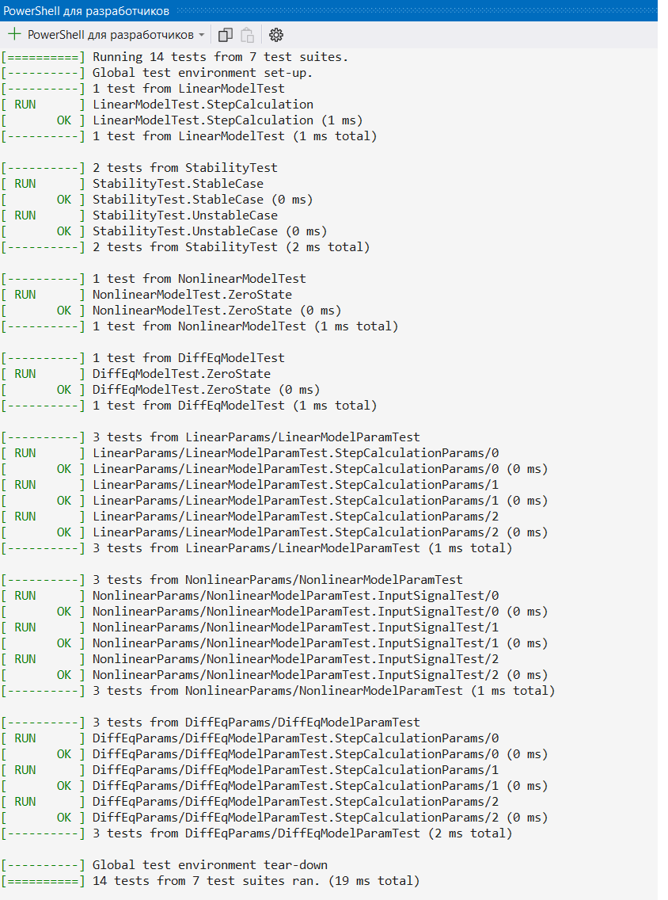
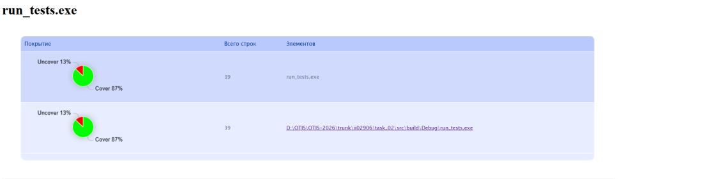
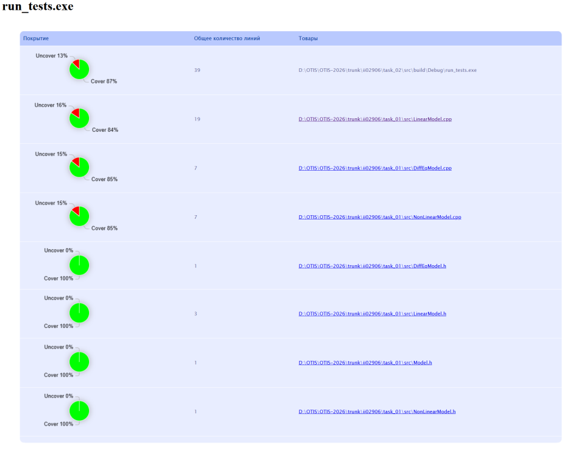

 Министерство образования Республики Беларусь

Учреждение образования

“Брестский Государственный технический университет”

Кафедра ИИТ

       

Лабораторная работа №2

По дисциплине “Общая теория интеллектуальных систем”

Тема: “Тестирование программы и анализ покрытия кода”

     

Выполнила:

Студентка 2 курса

Группы ИИ-29

Дешунина А.Ю.

Проверил:

Дворанинович Д. А.

   

Брест 2026

---

# Лабораторная работа №2

## Тестирование программы

Для тестирования использовалась библиотека **Google Test**. Написаны базовые и параметризованные тесты (`TEST_P`), покрывающие расчеты, устойчивость, граничные значения и подмену входных сигналов (пункт 9).

**Результат выполнения тестов:**
*(Вставь сюда свой 3-й скриншот, где терминал показывает [ PASSED ] 14 tests)*

## Покрытие кода

Покрытие замерено с помощью инструмента **OpenCppCoverage**.

**Общее покрытие:**
*(Вставь сюда свой 2-й скриншот с общим покрытием 87%)*

**Детализация по файлам:**
*(Вставь сюда свой 1-й скриншот, где список всех файлов и проценты)*

### Таблица покрытия

- **Способ запуска:** Локальный скрипт (`run_lab2.bat`)
- **Всего модульных тестов:** 14
- **Успешно пройденных тестов:** 14 / 14

| Модуль / Класс | Покрытие строк (Line Coverage) | Статус |
| :--- | :--- | :--- |
| `LinearModel.cpp` | 84 % | OK |
| `NonLinearModel.cpp` | 85 % | OK |
| `DiffEqModel.cpp` | 85 % | OK |
| `LinearModel.h` | 100 % | OK |
| `NonLinearModel.h` | 100 % | OK |
| `DiffEqModel.h` | 100 % | OK |
| `Model.h` | 100 % | OK |
| **Итоговый результат** | **87 %** | **Success** |